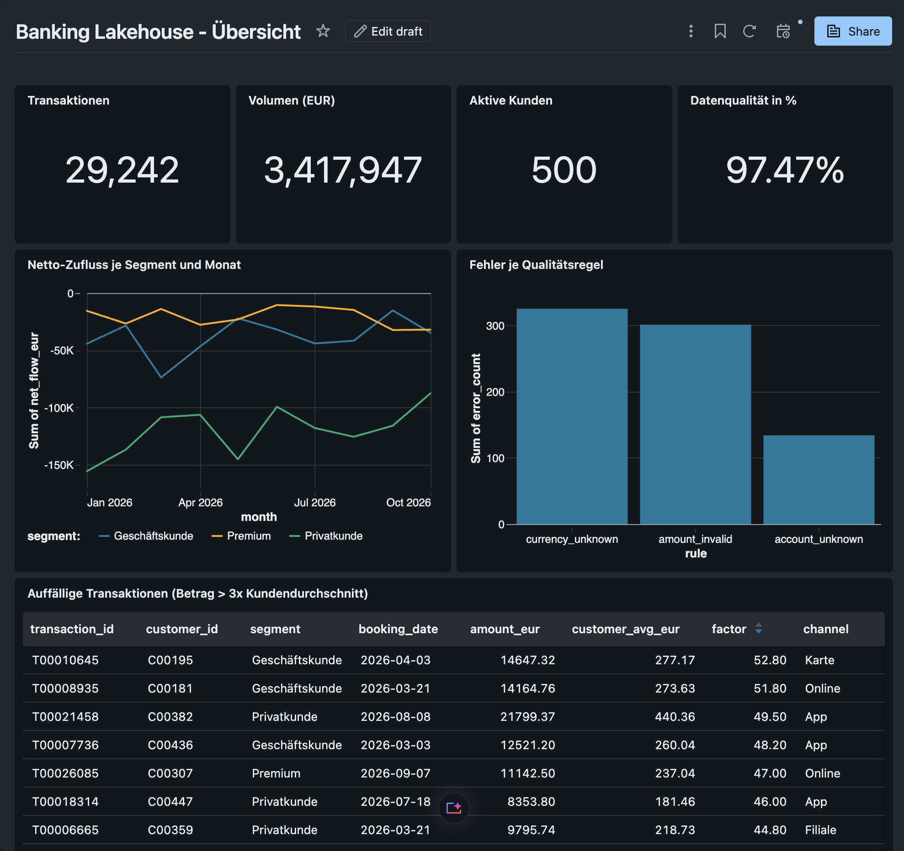
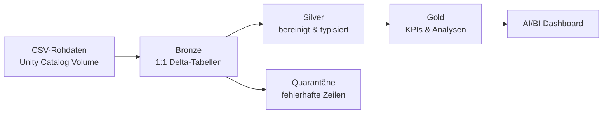
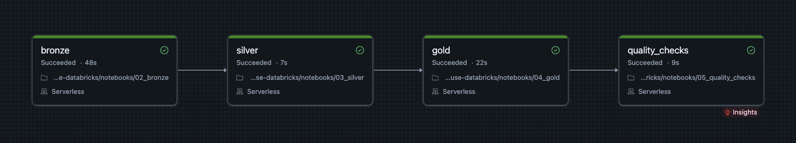

# Banking Lakehouse mit Databricks

End-to-End-Datenpipeline für synthetische Bankdaten nach der **Medallion-Architektur**
(Bronze → Silver → Gold) auf der Databricks Data Intelligence Platform.

## Architektur

## Ergebnisse

| Kennzahl | Wert |
|---|---|
| Rohdaten-Transaktionen (Bronze, inkl. Duplikate) | 30.600 |
| Saubere Transaktionen (Silver) | 29.242 |
| Fehlerhafte Zeilen (Quarantäne) | 758 |
| Datenqualitätsquote | 97,47 % |
| Aktive Kunden | 500 |
| Transaktionsvolumen | ca. 3,42 Mio. EUR |

## Was die Pipeline macht

- **Bronze:** lädt Kunden, Konten und ca. 30.600 Transaktionen unverändert, inkl. Quelldatei und Ladezeitpunkt
- **Silver:** Deduplizierung, Typisierung, drei Datumsformate, Komma-Dezimalzahlen,
  Währungsumrechnung in EUR, vier Datenqualitätsregeln; fehlerhafte Zeilen landen in der Quarantäne statt gelöscht zu werden
- **Gold:** Monats-KPIs je Segment, Customer 360, auffällige Transaktionen (> 3× Kundendurchschnitt und > 1.000 EUR),
  Datenqualitäts-Report
- **Tests:** automatische Checks (Eindeutigkeit, NULL-Werte, gültige Währungen, Abgleich Bronze = Silver + Quarantäne)
- **Orchestrierung:** Databricks Job mit vier abhängigen Tasks und täglichem Zeitplan

## Datenqualitätsregeln

| Regel | Prüft | Fehler |
|---|---|---|
| `currency_unknown` | Währung nicht in EUR/USD/CHF | 324 |
| `amount_invalid` | Betrag fehlt, ungültig oder ≤ 0 | 300 |
| `account_unknown` | Konto existiert nicht (referenzielle Integrität) | 132 |
| `date_invalid` | Datum in keinem bekannten Format | 0 |

Eine Zeile kann mehrere Regeln verletzen, daher ist die Summe größer als die Zahl der Quarantäne-Zeilen.

## Tech-Stack

Databricks (Free Edition, Serverless) · PySpark · Spark SQL · Delta Lake · Unity Catalog · Lakeflow Jobs ·
AI/BI Dashboards · Git

## Struktur

| Notebook | Inhalt |
|---|---|
| `00_setup` | Schema und Volume anlegen |
| `01_generate_data` | synthetische Daten mit absichtlichen Qualitätsfehlern |
| `02_bronze` | Rohdaten-Ingestion |
| `03_silver` | Bereinigung und Datenqualität |
| `04_gold` | Kennzahlen |
| `05_quality_checks` | automatische Tests |

## Nächste Schritte

- Inkrementelles Laden mit `MERGE INTO` und Auto Loader
- Deployment über Databricks Asset Bundles (CI/CD)

## Autor

Ismail Adruich – Data Engineer & Analyst
